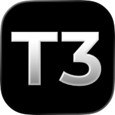

# About this fork

This is a fork of T3 Code that integrates a few additional features, including:

- **Whiteboard:** A tldraw whiteboard that sits side-by-side with T3 Code, allowing users to interact with agents (or other users) by editing and pointing to the whiteboard. Both the user and the agents can conveniently write links that point to a rectangular region on the whiteboard. Agents can also draw Mermaid diagrams on it, such as flowcharts and statecharts.
- **Better support for manually switching accounts mid-session:**
  - After hitting the usage limit of an account, the thread now retries after 2 minutes and 30 minutes in addition to the default retry behavior of T3 Code. This allows the thread to recover earlier if the user manually switches the account.
  - New Codex/Antigravity logins are picked up mid-session without a full restart.
- **Display mode per thread:** Right-click a thread and set Display mode to "Messages only" to hide the agent's work and see just your messages and the replies the agent sends to you with its `send_to_user` tool. The mode applies in the web and desktop apps, not in the mobile app.
  - "Messages + Dashboard" adds a Dashboard tab to the right panel (+ → Dashboard): six status slots that the agent writes with its `dashboard_set` tool and reads with `dashboard_get`. Each slot shows how long ago it changed, and new text stays highlighted until you click the slot. Select text in a slot to quote it with Cite, as you would in a message.
  - "Chat + Replies" keeps the main list short: it shows only first messages, and the replies to a message show in a Replies tab in the right panel (+ → Replies, or the reply line under a message). Point at a message and choose Reply to answer under it; the tab has its own reply box. Under each first message you see how many replies it has, how many are new, and a few generated words on what they are about. The agent answers a message with `send_to_user` and that message's id, so each answer lands under the message it answers.
  - In all three modes the agent sends one reply per message you type, and before a long task it may first send a short "on it" note; a thin line parts two agent messages in a row. To say more, it rewrites its reply in place with its `replace_send_to_user` tool. A rewritten reply shows a small "Edited" mark, and in Chat + Replies it counts as new.
- Copy buttons on pages in the preview browser now put the copied text into your own clipboard.
- **Two preview browser modes:** Settings → Browser → Preview browser picks the browser the server runs for preview tabs. **T3 native** (fast) is the default. It runs chrome-headless-shell, Chrome's small build that runs without a window. **Chrome** (slow) runs full Chrome, for pages that don't work in T3 native. On platforms where T3 has no Chrome for Testing build (Google's Chrome build for test automation), both choices run T3 native. Switching closes the open preview tabs.
- **Compact when idle for Claude threads:** a choice in Settings → Providers → Advanced → Compact idle threads. Besides compacting before the prompt cache expires, it compacts a large idle Claude thread (default 400K tokens or more) a set time (default 15 minutes) after the last message or answer from a user or a bot, so the compaction runs while no one waits for a reply. The token counts and the wait are set right under the choice.
- **Prune idle worker threads:** `t3 prune-worker-threads` deletes the messages, turn items, nodes, plans and runtime requests of idle worker threads. A worker thread is idle when it has no open run and, in the last 7 days, was not created, had no run requested or ended, and had no turn item or message updated. A worker thread is a subagent thread that an agent started. Subagent threads that a bot starts are workers too. Threads a person opens, bot threads themselves and a person's forks are never workers. An idle worker keeps its rows while recovery still needs the worker, or while a thread that keeps its own rows names the worker as parent or fork source. Pruned threads keep their thread row, runs, parent link and pull request links, so they still show up and open with no messages. The command runs only when you call it, so run it daily to keep worker transcripts from piling up. Other threads still grow the database. With `--dry-run`, the command only prints how many threads it would empty and how many rows it would delete. You can run the command while the server runs.
- **One way to start subagents in Claude and Codex threads:** T3 Code starts Claude and Codex sessions without the provider's own subagent tools: Claude's `Agent`, `Workflow`, `SendMessage` and `ListAgents`, and Codex's `spawn_agent` with its other collaboration tools. The agent starts every subagent, same provider and model included, with T3 Code's `delegate_task` tool, so each child is a T3 Code thread that you can open and follow.
- Enabling math rendering by default.
- Other small fixes.

The following is the README from upstream.

<p align="center">
  <a href="https://t3.codes">
    
  </a>
</p>

<h1 align="center">T3 Code</h1>

<p align="center">The open-source control plane for coding agents.</p>

<p align="center">
  <a href="https://t3.codes/download"><strong>Download</strong></a> ·
  <a href="https://apps.apple.com/us/app/t3-code-remote-claude-more/id6787819824">iOS</a> ·
  <a href="https://play.google.com/store/apps/details?id=com.t3tools.t3code">Android</a> ·
  <a href="https://app.t3.codes">Web</a> ·
  <a href="./docs/README.md">Docs</a> ·
  <a href="https://discord.gg/jn4EGJjrvv">Discord</a>
</p>

<p align="center">
  <a href="https://t3.codes">
    
  </a>
</p>

T3 Code runs the coding agents on your machine and gives them one fast interface. Start a thread at your desk, then approve the next step from your phone.

It works with Claude Code, Codex, Cursor, OpenCode, Grok Build, Antigravity, Kiro, Pi, Muse Code, fx, and any [ACP](./docs/user/providers-acp.md) agent. If an agent is set up on your computer, T3 Code can control it.

## What you get

- **Your subscriptions.** T3 Code does not resell tokens. It drives the agents you are already signed in to.
- **Every agent in one place.** Change models in the middle of a thread. Let Claude hand a task to Codex.
- **Desktop, web, and phone.** One server, and every client shows the same threads. There are apps for iOS and Android.
- **Remote ready.** Run agents on any machine. Connect over your local network, Tailscale, or [T3 Connect](./docs/user/remote-access.md).
- **Git built in.** Each thread can work in its own worktree. Review the diff, then commit, push, and open a pull request with one button.
- **Fast.** Performance is a feature here. We measure it, and we treat a dropped frame as a bug.
- **Open.** MIT licensed. If you don't like something, fork it.

## Install

### Desktop app

[Download T3 Code](https://t3.codes/download) for macOS, Windows, or Linux. You can also use a package manager:

| Platform       | Command                                                              |
| -------------- | -------------------------------------------------------------------- |
| macOS          | `brew install --cask t3-code`                                        |
| Windows        | `winget install T3Tools.T3Code` or `scoop install extras/t3code`     |
| Arch Linux     | `yay -S t3code-bin`                                                  |
| Nix            | `nix profile add github:NixOS/nixpkgs/nixos-unstable#t3code`         |
| Debian, Ubuntu | `.deb` from [Releases](https://github.com/pingdotgg/t3code/releases) |

### Command line

This installs the `t3` command. Run `t3` to start the server and open the web app.

```bash
curl -fsSL https://t3.codes/install.sh | sh
```

On Windows, in PowerShell:

```powershell
irm https://t3.codes/install.ps1 | iex
```

To try it once without an install, run `npx t3@latest`.

### Phone

Get the app from the [App Store](https://apps.apple.com/us/app/t3-code-remote-claude-more/id6787819824) or [Google Play](https://play.google.com/store/apps/details?id=com.t3tools.t3code). Then follow [remote access](./docs/user/remote-access.md) to connect it to your computer.

### Sign in to an agent

T3 Code needs one agent that is installed and signed in. For example, install [Claude Code](https://claude.com/product/claude-code) and run `claude auth login`, or install [Codex CLI](https://developers.openai.com/codex/cli) and run `codex login`.

[Provider setup](./docs/user/install.md#providers) has the steps for each agent. [Install T3 Code](./docs/user/install.md) covers nightly builds, AppImage, WSL, and NixOS.

## "Wait, what are you selling me?"

Nothing. We built T3 Code because we wanted the best possible development experience with agents. We were inspired by existing solutions like the Codex desktop app, Conductor, Claude Desktop and Cursor Glass, but none met our bar.

We wanted something performant, remote-ready, and truly open. If we ever go the wrong direction, we want you to have everything you need to fork and build the tool that you want.

## Documentation

- [Install and first run](./docs/user/install.md)
- [Remote access from a phone or another machine](./docs/user/remote-access.md)
- [Permission modes](./docs/user/permission-modes.md)
- [Source control](./docs/user/source-control.md)
- [Connect outside agents over MCP](./docs/user/outside-agents.md)
- [FAQ](./docs/user/faq.md)

[All docs](./docs/README.md) has the full list.

## Contributing

We have limited review capacity. Small, focused fixes are the most likely to be merged. Features need an approved discussion first.

- Read [CONTRIBUTING.md](./CONTRIBUTING.md) before you report a bug or open a pull request.
- Put feature requests in [Ideas](https://github.com/pingdotgg/t3code/discussions/categories/ideas).
- Build from source with the [development runbook](./docs/operations/development.md#first-checkout). The [architecture overview](./docs/internals/overview.md) explains how it works.
- Get help in [Discord](https://discord.gg/jn4EGJjrvv).

## License

[MIT](./LICENSE)
